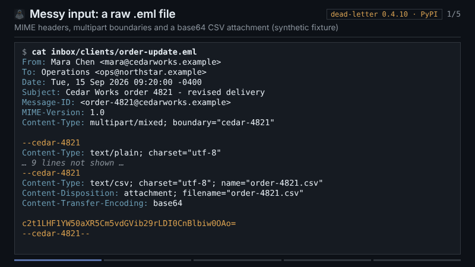

# Email conversion recipes

The first five recipes use the same [synthetic two-message inbox](fixtures/inbox/).
Run shell commands from the repository root after installing the relevant
[CLI or MCP route](../reference/distribution.md). The sample contains a quoted
reply and a small CSV attachment; it contains no private mail.

| Goal | Recipe |
| --- | --- |
| Put an `.eml` folder in an Obsidian vault or Markdown tree | [Folder to Markdown](folder-to-markdown.md) |
| Prepare structured text for a RAG pipeline | [RAG preprocessing](rag-preprocessing.md) |
| Ask a local Claude or Codex MCP client to convert mail | [Local agent MCP](local-agent-mcp.md) |
| Keep Markdown, source mail, and decoded files together | [Durable Cabinet](durable-cabinet.md) |
| Audit a conversion and inspect quality signals | [Report and diagnostics](report-and-diagnostics.md) |
| Move a Gmail Takeout export into Obsidian, with labels and attachments | [Takeout to Obsidian](takeout-to-obsidian.md) |

*A 27-second capture of released dead-letter 0.4.10 run on this inbox. It
shows only real command output. See the [MP4](demo/dead-letter-demo.mp4) and
the [storyboard and capture record](demo/README.md).*

The CLI and Python examples in these guides were exercised against the released 0.4.0
package. The MCP examples were exercised against its real stdio server; this
does not establish a named GUI client's install or model behavior. All five
preserve the input `.eml` files.

The Takeout recipe has its own [synthetic Takeout sample](takeout-sample/):
a five-message ZIP, the vault that released 0.4.10 produces from it, and the
conversion report. It was run with released 0.4.10 and the vault was opened
in Obsidian 1.12.4; the input archive is left unchanged. See the [runtime contract](../reference/v4-runtime-contracts.md)
and [quality diagnostics](../reference/quality-diagnostics.md) for exact behavior.
